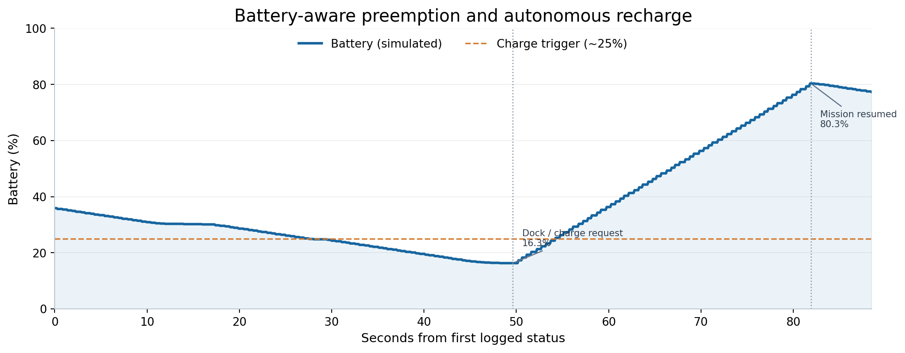
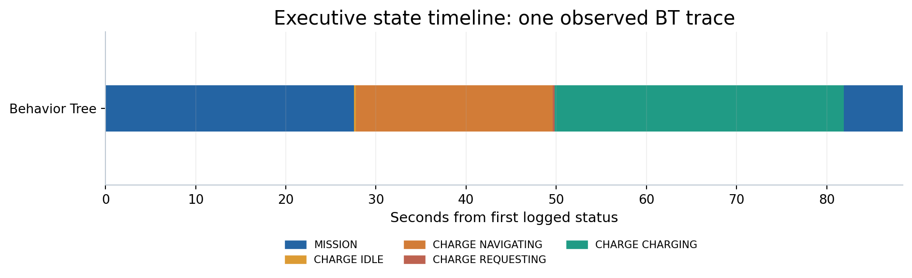
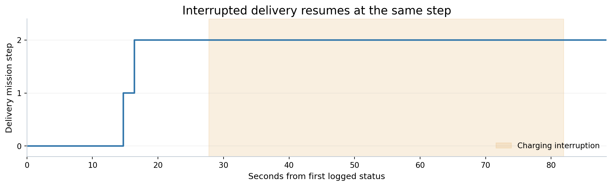

# Autonomous Mobile Robot Decision & Behavior Intelligence Platform (AMR-BIP)

[](https://docs.ros.org/en/humble/)
[](https://classic.gazebosim.org/)
[](https://github.com/HARSHAVARDHAN-SEKAR/Autonomous-Mobile-Robot-Decision-Behavior-Intelligence-Platform-AMR-BIP-/actions/workflows/ci.yml)
[](LICENSE)

**AMR-BIP** is a Docker-based ROS 2 research and portfolio platform for investigating how an autonomous mobile robot **selects missions, interrupts work, responds to faults, manages energy and resumes execution**. It implements three interchangeable decision engines over the same simulated robot and navigation stack:

- **Behavior Tree (BT)**
- **Finite State Machine (FSM)**
- **Utility-based arbitration**

The navigation subsystem intentionally does **not** use Nav2: it provides an explicit A* planner, path smoothing, pure-pursuit controller, 2D LiDAR obstacle checks, bounded replanning and a cancellable ROS 2 `GoToPose` action. This makes decision-layer preemption and navigation behavior inspectable.

> **Validation scope:** The evidence below comes from **Gazebo simulation**, not a physical robot. A successful single run is not a reliability benchmark. The BT/FSM/Utility comparison infrastructure exists, but measured three-engine comparisons have **not** been published.

## Demonstration and measured results

**[Technical report (PDF)](results/2026-10-18_bt_gazebo/AMR_BIP_BT_Validation_Report.pdf)** · **[Methodology and limitations](results/2026-10-18_bt_gazebo/REPORT.md)** · **[Recording guide](docs/AMR_BIP_RECORDING_GUIDE.md)**

| Check | Recorded result | Evidence / limitation |
|---|---|---|
| ROS 2 workspace build | **8 packages built** | Local Docker / ROS 2 Humble build |
| Core tests | **22 passed, 0 failed** | `colcon test --packages-select bip_core` |
| Static waypoint reachability | **7/7 waypoint pairs reachable** | Offline grid-planning check, **not** a driving test |
| Previously blocked inspection goal | **SUCCEEDED** in **52.27 s** | Standalone `/go_to_pose` action run; result is separate from the BT trace |
| Behavior Tree patrol | **Completed** | Present in recorded BT mission history |
| Behavior Tree room inspection | **Completed** | Present in recorded BT mission history |
| Automatic low-battery diversion | **Observed** | BT switched to `CHARGE_NAVIGATING` at **24.9%** battery |
| Docking and charging | **Observed** | Charging began at **16.3%** and reached approximately **80.3%** |
| Resume interrupted delivery | **Observed** | Returned to `MISSION`, `deliver_package`, **step 2** |
| Final three-mission `DONE` state | **Not captured** | Last recorded status was delivery still navigating |
| Comparative BT/FSM/Utility performance | **Not measured** | Requires controlled multi-run benchmarks |

The evidence dataset consists of **880 ROS 2 status messages over 88.47 seconds** from the recorded portion of one BT simulation run. Its first sample is already in the delivery mission: earlier patrol/inspection completion is visible in the `completed` field, rather than captured from the beginning of those missions.

### Battery and behavior evidence



*Simulated battery percentage. The robot interrupted delivery, navigated to the dock, charged and resumed the same mission step.*





Reproducible sources: [`bt_status.jsonl`](results/2026-10-18_bt_gazebo/bt_status.jsonl), [`bt_status.csv`](results/2026-10-18_bt_gazebo/bt_status.csv), [`summary.json`](results/2026-10-18_bt_gazebo/summary.json) and [`tools/plot_bt_evidence.py`](tools/plot_bt_evidence.py). The report does not claim an end-to-end delivery success because the published trace stops before that result.

### Recorded video

A genuine Gazebo screen recording is **being prepared**. The documentation includes [terminal-by-terminal recording instructions](docs/AMR_BIP_RECORDING_GUIDE.md). No video is linked until it has been captured and checked against the actual ROS 2 status log.

## Architecture

```text
┌─────────────────────────────────────────────────────────────┐
│           Interchangeable mission decision engine          │
│   BT executive  |  FSM executive  |  Utility executive      │
├─────────────────────────────────────────────────────────────┤
│                     Shared skills API                       │
│     Navigate / Cancel / Battery / Charge / Emergency       │
├─────────────────────────────────────────────────────────────┤
│ bip_navigation  A* + smoothing + pure pursuit + replanning │
│ bip_battery     motion-dependent drain + docking/charging   │
│ bip_chaos       fault injection and obstacle scenarios      │
├─────────────────────────────────────────────────────────────┤
│ Gazebo Classic 11  |  differential drive  |  2D LiDAR/odom │
├─────────────────────────────────────────────────────────────┤
│ bip_benchmark   controlled scenarios + metrics capture      │
└─────────────────────────────────────────────────────────────┘
```

| ROS 2 package | Responsibility |
|---|---|
| `bip_core` | ROS-independent map/grid search, behavior primitives, FSM, utility arbitration and mission progress |
| `bip_interfaces` | `GoToPose` action and battery/obstacle services |
| `bip_description` | Differential-drive robot description, Gazebo world and simulation launch |
| `bip_navigation` | A* route planning, pure pursuit, scan checks, bounded recovery and goal execution |
| `bip_battery` | Simulated battery dynamics and charging dock |
| `bip_executive` | BT, FSM and utility-based mission executives |
| `bip_chaos` | Configurable emergency and path-blockage disturbances |
| `bip_benchmark` | Reset protocol, scheduled fault scenarios and status/metric collection |

### Navigation configuration used for the validated inspection goal

After a reproducible wall-blocking failure with the original settings, the experimental planner was configured with **0.30 m map inflation plus a 0.20 m extra planning margin (0.50 m total)**. The scan-based front stop threshold was **not** reduced. The inspection goal subsequently succeeded in Gazebo. This supports the clearance-mismatch hypothesis for that trial, but does not prove general collision-free or repeated-run performance.

## Quick start — Docker + ROS 2 Humble

Commands under **Ubuntu host** run in a normal Linux terminal. Commands under **Inside Docker** must be run after `docker exec -it amr-bip bash`. You cannot source `/ws/install/setup.bash` or use `/ws/src/...` on the Ubuntu host unless you created those paths there yourself.

**Prerequisites:** Docker Engine and Docker Compose, an Ubuntu X11 desktop for the optional Gazebo GUI, and a locally built `amr-bip:humble` image. Full setup and scenarios: [RUN_GUIDE.md](RUN_GUIDE.md).

**Ubuntu host — start the container**

```bash
# Run from the cloned repository root
cd ~/Downloads/Autonomous-Mobile-Robot-Decision-Behavior-Intelligence-Platform-AMR-BIP-
docker build -t amr-bip:humble -f docker/Dockerfile .  # first time / after Dockerfile changes
docker compose up -d --no-build
xhost +si:localuser:root
```

**Terminal 1 — build and launch Gazebo server (inside Docker)**

```bash
docker exec -it amr-bip bash
source /opt/ros/humble/setup.bash
cd /ws
colcon build --symlink-install
source /ws/install/setup.bash
ros2 launch bip_description sim.launch.py headless:=true
```

**Terminal 2 — Gazebo GUI (optional, inside a new Docker shell)**

```bash
docker exec -it amr-bip bash
source /opt/ros/humble/setup.bash
source /ws/install/setup.bash
export QT_X11_NO_MITSHM=1
export LIBGL_ALWAYS_SOFTWARE=1
gzclient --verbose
```

The separate GUI and software-rendering configuration helped on the tested Ubuntu/AMD graphics setup. Do **not** launch a second `sim.launch.py` instance.

**Terminal 3 — navigation, battery and fault nodes (inside Docker)**

```bash
docker exec -it amr-bip bash
source /opt/ros/humble/setup.bash
source /ws/install/setup.bash
ros2 launch bip_navigation stack.launch.py
```

**Terminal 4 — reset the simulation (inside Docker, before launching the executive)**

```bash
docker exec -it amr-bip bash
source /opt/ros/humble/setup.bash
source /ws/install/setup.bash
ros2 service call /reset_world std_srvs/srv/Empty '{}'
ros2 service call /nav/clear_obstacles std_srvs/srv/Trigger '{}'
ros2 service call /battery/stop_charging std_srvs/srv/Trigger '{}'
ros2 service call /battery/set bip_interfaces/srv/SetBattery '{level: 100.0}'
```

**Terminal 5 — launch one executive (inside Docker)**

```bash
docker exec -it amr-bip bash
source /opt/ros/humble/setup.bash
source /ws/install/setup.bash
ros2 launch bip_executive executive.launch.py engine:=bt
```

**Terminal 6 — readable live status (inside Docker)**

```bash
docker exec -it amr-bip bash
source /opt/ros/humble/setup.bash
source /ws/install/setup.bash
python3 /ws/src/bip_benchmark/scripts/bt_live_status_monitor.py
```

For raw ROS 2 status instead:

```bash
ros2 topic echo /executive/status --field data
```

The monitor script must exist in the cloned repository and be mounted at `/ws/src/bip_benchmark/scripts/`. If you stop the executive, `/executive/status` may disappear; this is expected.

## Tests and reproducibility

**Inside Docker:**

```bash
source /opt/ros/humble/setup.bash
cd /ws
colcon build --symlink-install
source /ws/install/setup.bash
colcon test --packages-select bip_core
colcon test-result --verbose
```

For the recorded local checkout, this returned **22 tests, 0 errors, 0 failures, 0 skipped**. The seven-waypoint offline clearance experiment can be repeated using the planning-clearance experiment kit described in the [technical report](results/2026-10-18_bt_gazebo/REPORT.md). Run tests again after changing the source.

### Controlled decision-engine benchmarks (experimental)

The repository supports a benchmark-oriented workflow: launch an executive with `wait_for_start:=true`, then run the benchmark node to reset the world, restore battery and obstacle state, and start the scenario clock from a common event. Available scenario identifiers include `baseline`, `battery_drop`, `emergency`, `blocked_path` and `full_chaos`.

```bash
# Inside Docker, after navigation is running
ros2 launch bip_executive executive.launch.py engine:=bt wait_for_start:=true
```

In a separate sourced Docker terminal:

```bash
ros2 run bip_benchmark benchmark_node --ros-args \
  -p scenario:=full_chaos \
  -p out_dir:=/ws/results
```

Start a **fresh executive process for every scenario/engine**. No benchmark ranking or superiority claims are made until BT, FSM and Utility have been measured under the same scenarios across repeated runs.

## Limitations and planned validation

- The displayed battery is a **simulation model**, not an actual battery measurement.
- The October 18 BT trace verifies docking, charging and resumed navigation, **not** final delivery completion.
- One successful isolated inspection action is not proof of robust navigation around all obstacles.
- Emergency-stop recovery, blocked-path fault injection and repeated-trial reliability still require end-to-end evidence.
- The ROS 2 control loop has only been validated in simulation; deployment on physical robots requires further collision-safety and system-level testing.
- Planned extensions to world-state reasoning, risk assessment and explainable arbitration are documented in [ROADMAP.md](ROADMAP.md).

## Project files

- [Run guide](RUN_GUIDE.md)
- [Validation and video checklist](VALIDATION_AND_VIDEO.md)
- [Experiment report](results/2026-10-18_bt_gazebo/REPORT.md)
- [Technical PDF report](results/2026-10-18_bt_gazebo/AMR_BIP_BT_Validation_Report.pdf)
- [Recording guide](docs/AMR_BIP_RECORDING_GUIDE.md)
- [Release notes](RELEASE_NOTES.md)

## Author

**Harshavardhan Coimbatore Sekar** · [GitHub](https://github.com/HARSHAVARDHAN-SEKAR)

## License

MIT — see [LICENSE](LICENSE).
